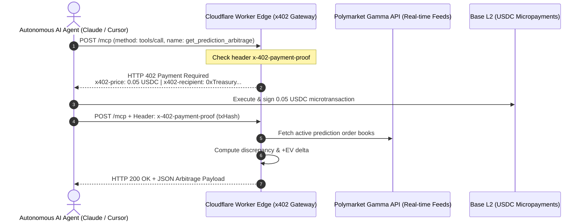

# ArbitraX (x402 & MCP Monetization Engine)

> **High-Stakes Prediction Markets & Sports Odds Arbitrage MCP Server**  
> Liquidated autonomously via the **HTTP 402 Payment Required (x402)** protocol on Base (USDC).

---

## 🚀 Business Overview & Value Proposition

Traditional websites rely on human eye-balls (Google AdSense) or credit card checkout forms (Stripe). **AI Agents cannot fill out credit card forms or resolve CAPTCHAs.**

`ArbitraX` delivers high-frequency statistical arbitrage, +EV prediction spreads (Polymarket vs. Bookmakers), and algorithmic whale accumulation telemetry to AI agents (Claude, Cursor, AutoGPT, trading bots) via the **Model Context Protocol (MCP)**, collecting instant micropayments via **HTTP 402 & USDC**.

### Key Advantages
1. **Niche Fit:** Serves bots and traders who *already* hold automated liquid crypto wallets.
2. **High-Value Alpha:** Does not sell generic public prices; delivers real-time statistical edges (+EV arbitrage spreads) where agents can capitalize instantly.
3. **Frictionless M2M Commerce:** Zero account creation, zero KYC friction for autonomous agents. Transactions settle in milliseconds on the Base L2 network.

---

## 🛠️ MCP Tool Catalog & Freemium Funnel

ArbitraX implements a **Dual-Funnel Freemium Strategy** (M2M + H2M) designed to maximize adoption with zero onboarding friction:

| Tool Name | Purpose | Tier / Pricing | Target Consumer |
| :--- | :--- | :---: | :--- |
| `search_prediction_events` | Searches active prediction markets with live outcome pricing and liquidity volume. | **FREE ($0.00)**<br/>*(Lead Magnet)* | Research agents, LLM searchers, news summarizers |
| `get_prediction_arbitrage` | Scans Polymarket and calculates +EV statistical discrepancies against consensus models. | **Freemium Preview**<br/>(1 Free Sample / **$0.05** Full Scan) | Arbitrage bots, election & event prediction models |
| `get_whale_macro_signals` | High-volume OTC and on-chain whale accumulation alerts for Crypto, Gold, and Oil. | **$0.10 USDC**<br/>*(VIP Signals)* | Macro momentum bots, algorithmic hedge funds |

### ⚡ Freemium Teaser & Lead Magnet Architecture
1. **Free Discovery & Lead Magnet:** `search_prediction_events` is 100% free with zero payment required, letting agents index markets instantly.
2. **Freemium Arbitrage Preview:** Calling `get_prediction_arbitrage` without payment proof returns **1 real live high-conviction +EV opportunity for free**, accompanied by a locked orderbook count (e.g. 22 additional spreads available) and clear x402 payment instructions.
3. **Interactive Web Scanner Demo:** Anyone can test real-time arbitrage detection directly on the landing page (`/v1/demo`) with a single click.
4. **Pro Deep-Orderbook Unlock:** Providing a valid 0.05 USDC payment proof unlocks all 20+ live spreads, Kelly sizing parameters, and cross-market execution routes.

---

## ⚙️ Architecture & Sequence



---

## 💻 Claude Desktop & Cursor Integration

Add this entry to your `claude_desktop_config.json`:

```json
{
  "mcpServers": {
    "arbitrax": {
      "url": "https://arbitrax-gateway.inprotechve.workers.dev/mcp",
      "headers": {
        "x-402-payment-proof": "{\"txHash\":\"0x...\",\"payer\":\"0xAgentWallet\",\"amount\":\"0.05\"}"
      }
    }
  }
}
```

---

## 🧪 Local Testing & Simulation

Execute the end-to-end agent simulation test:

```bash
npm run test:agent
```

---

## 🛡️ Project Isolation & Governance

This project adheres to the **Workspace Isolation Protocol (`protocolo-aislamiento-proyectos.md`)**:
- Completely decoupled from corporate CRM, gremial portals, and other local apps.
- Standalone dependencies, independent wrangler configuration, and zero cross-contamination.
